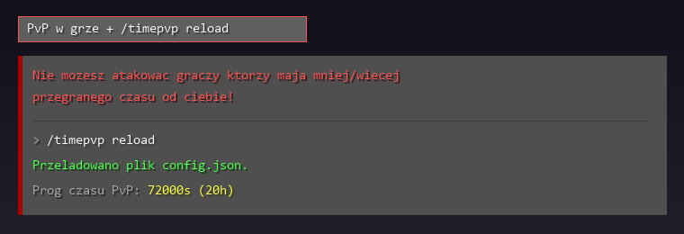

# FranekTimePvP


Prosty plugin na blokade PvP wzgledem przegranego czasu na serwerze. Gracze ktorzy maja przegrane mniej niz ustawiony czas w configu moga bic sie tylko miedzy soba, a ci co maja wiecej - tylko ze soba.

Domyslnie ustawione jest 20h (`72000` sekund), wiec nowy gracz po wejsciu nie dostanie od razu na dziure od kogos kto siedzi na serwerze od startu edycji.

## Podglad w grze



## Komendy

| Komenda | Co robi |
|---|---|
| `/timepvp reload` | przeladowuje config (permisja `franek.timepvp.admin` lub `op`) |

## Config

`plugins/FranekTimePvP/config.json`, tworzy sie sam:

```json
{
  "options": {
    "pvpTimeSeconds": 72000,
    "cantAttackMessage": "&cNie mozesz atakowac graczy ktorzy maja mniej/wiecej przegranego czasu od ciebie!"
  }
}
```

Mozna uzywac zwyklych kolorow `&` i HEX (`#RRGGBB`).

## Instalacja

Jar z folderu [`releases/`](releases/) wrzucasz do `plugins/` na serwerze (Spigot / Paper 1.20.x+) i restart.

## Budowanie

```bash
mvn package
```

Wychodzi `target/FranekTimePvP-1.0.jar`.

## Licencja

Wszelkie prawa zastrzezone. Autor: franekk ([GitHub](https://github.com/Blejziak)).
